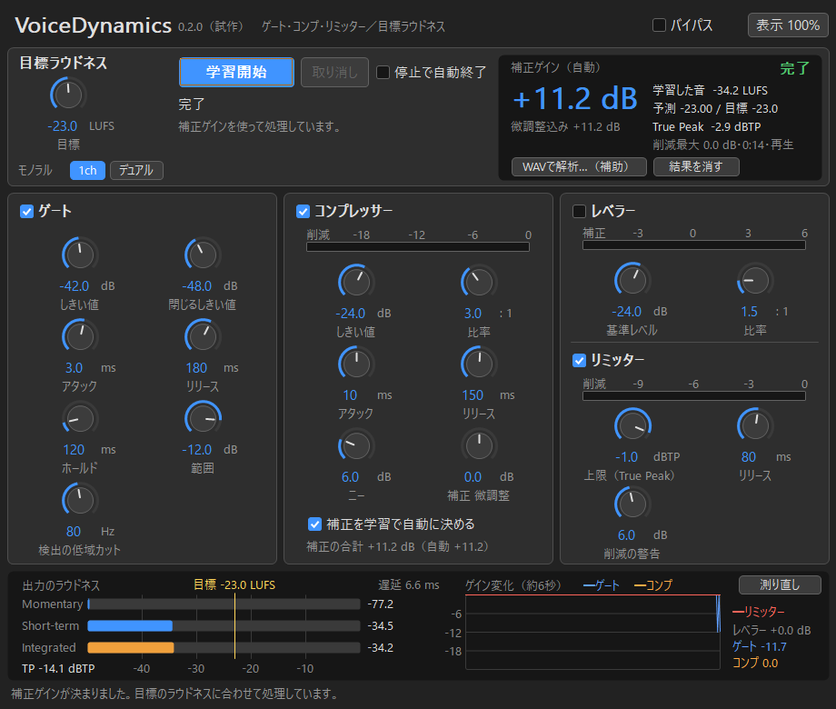

# VoiceDynamics

Windows x64用のVST3プラグインです。収録後の声（ゲームボイスなど）にインサートし、**ゲート → （レベラー）→ コンプ → 補正ゲイン → True Peakリミッター** をかけて、出力全体のラウドネス（LUFS-I）を目標値に合わせます。

A Windows x64 VST3 voice dynamics chain (gate, leveler, compressor, true-peak limiter) that brings the whole take to a target integrated loudness (LUFS-I). MIT licensed.



## 特長
- ゲート、レベラー、コンプレッサー、リミッターを1画面で扱えます。画面はAdobe Auditionの「ダイナミクス」に近い配置です。
- 目標ラウドネスを決めて**一度再生して学習**すると、補正ゲインが自動で決まり、出力が目標に合います。測り方はITU-R BS.1770-5 / EBU R128に準拠しています。
- 学習後に目標やリミッターの上限を変えた場合は、記録した音から自動で計算し直すので、再生し直す必要はありません。
- True Peakの上限を指定できます（初期値 −1 dBTP）。
- 遅延は約6.7 msで、設定によらず一定です。インサートで使える低遅延です。
- 補助として、WAVファイルを読み込んで解析することもできます。

## 導入
1. [Releases](https://github.com/Kansoku111/VoiceDynamics/releases) からZIPを落として展開します。
2. `VoiceDynamics.vst3` フォルダーを `C:\Program Files\Common Files\VST3\` にコピーします。
3. DAWでプラグインを再スキャンします。

動作環境：Windows 10/11 x64、VST3対応のDAW。開発時はStudio One 6を対象にし、REAPERでの利用を想定しています。

## 使い方
1. 声のトラックにインサートし、目標ラウドネス（初期値 −23 LUFS）とリミッターの上限を決めます。
2. ［学習開始］を押し、**トラックを先頭から最後まで再生**します。DAWの書き出し（オフライン処理）で流しても学習できる設計で、その場合は実時間より速く終わります（REAPERのDry runでの動作は未確認です）。
3. ［学習終了］を押します。「停止で自動終了」をオンにしていれば、停止したときに自動で終わります。補正ゲインが決まり、結果はプロジェクトに保存されます。
4. 書き出すと、出力のIntegratedが目標に合います。

ゲート、レベラー、コンプの設定を変えた後は、学習し直してください。途中から再生した場合、早送りや巻き戻しをした場合、サンプルレートが変わった場合は、画面に警告が出ます。

## 状態
試作版です。自動試験、Steinberg validator、pluginval（strictness 10）、Pythonによる独立した測定で確認しています。**DAWでの実機確認と、耳での評価はまだ途中**です。不具合は [Issues](https://github.com/Kansoku111/VoiceDynamics/issues) へお願いします。

## ビルド
Visual Studio 2022とGitが必要です。VST3 SDK（3.8.0、MIT）とCMakeは、スクリプトが取得します。

```powershell
.\tools\setup.ps1
.\tools\build.ps1   # ビルドとすべての試験
```

詳しくは [docs/BUILD.md](docs/BUILD.md) を見てください。設計の判断は [docs/DECISIONS.md](docs/DECISIONS.md)、実機確認の手順は [docs/USER-TEST.md](docs/USER-TEST.md) にあります。

## ライセンス
[MIT](LICENSE)。第三者のライセンスは [THIRD_PARTY_NOTICES.md](THIRD_PARTY_NOTICES.md) と `licenses/` にあります。VSTはSteinberg Media Technologies GmbHの商標です。
